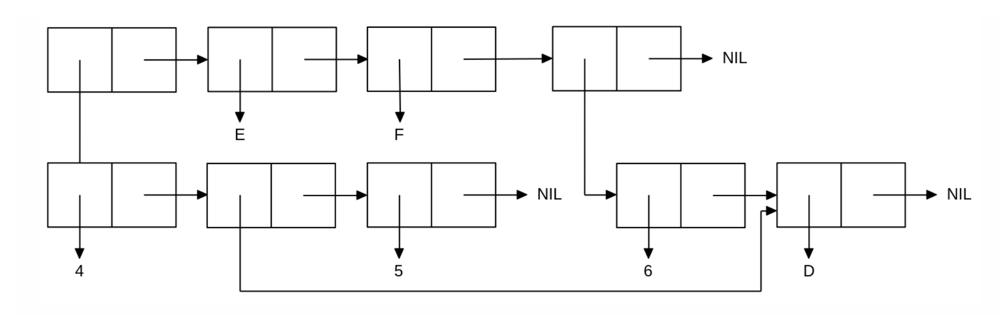
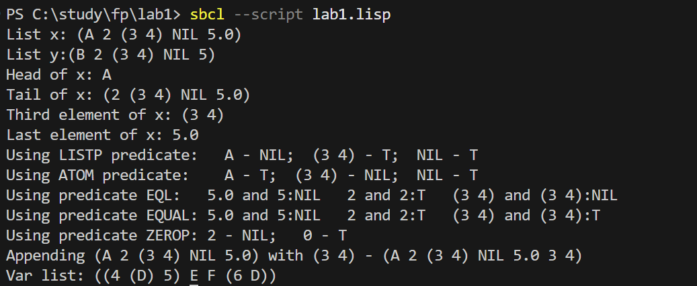

<p align=center><b>МОНУ НТУУ КПІ ім. Ігоря Сікорського ФПСПМ СПіСКС</b></p>
<p align=center><b>Звіт з лабораторної роботи 1</b><br/>
"Обробка списків з використанням базових функцій"<br/>
дисципліни "Вступ до функціонального програмування"</p>
 
<p align=right><b>Студент</b>: Ткаченко Володимир КВ-33</p>
<p align=right><b>Рік</b>: 2026</p>

## Загальне завдання
``` r
(let ((x  nil) (y  nil))

; 1
(setq  x (list  'A 2 (list  3  4) (list) 5.0))

(setq  y (cons  'B (cons  2 (cons (cons  3 (cons  4  nil)) (cons () (cons  5  nil))))))

(format  t  "List x: ~A~%List y:~A~%"  x  y)

; 2
(format  t  "Head of x: ~A~%" (first  x))

; 3
(format  t  "Tail of x: ~A~%" (rest  x))

; 4
(format  t  "Third element of x: ~A~%" (third  x))

; 5
(format  t  "Last element of x: ~A~%" (first(last  x)))

; 6
(format  t  "Using LISTP predicate: ~A - ~A; ~A - ~A; ~A - ~A~%" (first  x) (listp (first  x)) ( third  x) (listp (third  x)) (cadddr  x) (listp (cadddr  x)))

(format  t  "Using ATOM predicate: ~A - ~A; ~A - ~A; ~A - ~A~%" (first  x) (atom (first  x)) ( third  x) (atom (third  x)) (cadddr  x) (atom (cadddr  x)))

; 7
(format  t  "Using predicate EQL: ~A and ~A:~A  ~A and ~A:~A  ~A and ~A:~A~%" (first (last  x)) (first (last  y)) (eql (first (last  x)) (first (last  y))) (second  x) (second  y) (eql (second  x) (second  y)) (third  x) (third  y) (eql (third  x) (third  y)))

(format  t  "Using predicate EQUAL: ~A and ~A:~A  ~A and ~A:~A  ~A and ~A:~A~%" (first (last  x)) (first (last  y)) (equal (first (last  x)) (first (last  y))) (second  x) (second  y) (equal (second  x) (second  y)) (third  x) (third  y) (equal (third  x) (third  y)))

(format  t  "Using predicate ZEROP: ~A - ~A; ~A - ~A~%" (second  x) (zerop (second  x)) 0 (zerop  0))

; 8
(format  t  "Appending ~A with ~A - ~A~%"  x (third  x) (append  x (third  x)))

)
```
## Варіант 16
<p align-center>

</p>

``` r
(defun  build-list()

	(let* ((x (list  6  'D)) (y (list  4 (last  x) 5)))
		(list  y  'E 'F x)
	)
)

(format  t  "Var list: ~A~%" (build-list))
``` 
## Результат виконання роботи у консолі
<p align=center>

</p>
