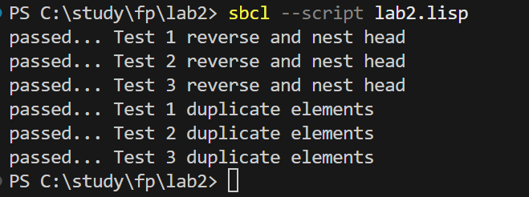

<p align=center><b>МОНУ НТУУ КПІ ім. Ігоря Сікорського ФПСПМ СПіСКС</b></p>
<p align=center><b>Звіт з лабораторної роботи 2</b><br/>
"Рекурсія"<br/>
дисципліни "Вступ до функціонального програмування"</p>
 
<p align=right><b>Студент</b>: Ткаченко Володимир КВ-33</p>
<p align=right><b>Рік</b>: 2026</p>

## Загальне завдання
Реалізуйте дві рекурсивні функції, що виконують деякі дії з вхідним(и) списком(-ами), заможливості/необхідності використовуючи різні види рекурсії. Функції, які необхідно реалізувати, задаються варіантом (п. 2.1.1). Вимоги до функцій:
1. Зміна списку згідно із завданням має відбуватись за рахунок конструювання нового
списку, а не зміни наявного (вхідного).
2. Не допускається використання функцій вищого порядку чи стандартних функцій
для роботи зі списками, що не наведені в четвертому розділі навчального
посібника.
3. Реалізована функція не має бути функцією вищого порядку, тобто приймати функції
в якості аргументів.
4. Не допускається використання псевдофункцій (деструктивного підходу).
5. Не допускається використання циклів.<br/>
Кожна реалізована функція має бути протестована для різних тестових наборів. Тести мають бути оформленні у вигляді модульних тестів (див. п. 2.3).<br/>
Додатковий бал за лабораторну роботу можна отримати в разі виконання всіх наступних умов:<br/>
+ робота виконана до дедлайну (включно з датою дедлайну
+ крім основних реалізацій функцій за варіантом, також реалізовано додатковий варіант однієї чи обох функцій, який працюватиме швидше за основну реалізацію, не порушуючи при цьому перші три вимоги до основної реалізації (вимоги 4 і 5 можуть бути порушені), за виключенням того, що в разі необхідності можна також використати стандартну функцію copy-list
## Варіант 16 (1)
1. Написати функцію `reverse-and-nest-head`, яка обертає вхідний список та утворює вкладeну структуру з підсписків з його елементами, починаючи з голови:
``` lisp
CL-USER> (reverse-and-nest-head '(a b c))
(((C) B) A)
```
2. Написати функцію `duplicate-elements`, що дублює елементи вхідного списку
задану кількість разів:
``` lisp
CL-USER> (duplicate-elements '(a b c) 3)
(A A A B B B C C C)
```
## Лістинг функції reverse and nest head
``` lisp
(defun reverse-and-nest-head (input-list)
    (reverse-and-nest-head-inner (cdr (reverse input-list)) (last input-list))
)

(defun reverse-and-nest-head-inner (input-list-inner output-list-inner)
    (cond
        ((null input-list-inner) output-list-inner)
        (t (reverse-and-nest-head-inner (cdr input-list-inner) (list output-list-inner (first input-list-inner))))
    )
)
```
## Тестові набори та утиліти
``` lisp
(defun check-my-reverse-function (name input expected)
(format t "~:[FAILED~;passed~]... ~a~%"
(equal (reverse-and-nest-head input) expected)
name))

(defun run-reverse-and-nest-head-tests ()
    (check-my-reverse-function "Test 1 reverse and nest head" '(a b c 1 2 3 pi "end") '(((((((("end") PI) 3) 2) 1) C) B) A))
    (check-my-reverse-function "Test 2 reverse and nest head" nil nil)
    (check-my-reverse-function "Test 3 reverse and nest head" '(h) '(h))
)
```
## Лістинг функції duplicate elements
``` lisp
(defun repeat-element (elem count)
    (if (<= count 0)
        nil
        (cons elem (repeat-element elem (- count 1)))
    )
)

(defun duplicate-elements (input-list n)
    (cond
        ((or (null input-list) (<= n 0)) nil)
        (t (append (repeat-element (first input-list) n) (duplicate-elements (cdr input-list) n))
        )
    )
)
```
## Тестові набори та утиліти
``` lisp
(defun check-my-duplicate-function (name input n expected)
(format t "~:[FAILED~;passed~]... ~a~%"
(equal (duplicate-elements input n) expected)
name))

(defun run-duplicate-elements-tests ()
    (check-my-duplicate-function "Test 1 duplicate elements" '(a b c 1 2 3 pi "end") 3 '(a a a b b b c c c 1 1 1 2 2 2 3 3 3 pi pi pi "end" "end" "end"))
    (check-my-duplicate-function "Test 2 duplicate elements" nil 5 nil)
    (check-my-duplicate-function "Test 3 duplicate elements" '(h) 10 '(h h h h h h h h h h))
)
```
## Тестування 
``` lisp
(defun run-all-tests ()
    (run-reverse-and-nest-head-tests)
    (run-duplicate-elements-tests)
)

(run-all-tests)
```
<p align=center>

</p>

